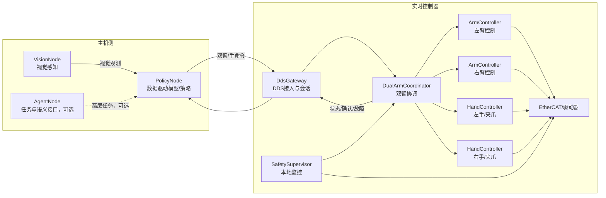

# ROCOS 双臂 DDS 分布式接口设计

**版本：** v0.1（接口讨论稿）  
**范围：** 双臂、视觉、手/夹爪、主机模型与实时运动控制器之间的 DDS 接口  
**本版本不包含：** 代码实现、DDS 厂商选型、完整安全认证、LLM/MCP 工具层和原始图像传输实现

## 1. 设计目标

系统由两类设备组成：

- **主机（Host）**：运行视觉算法、数据驱动模型、策略模型或上层任务逻辑，计算资源充足，但不承担硬实时伺服。
- **实时运动控制器（RT Controller）**：运行双臂控制、插补、伺服、EtherCAT/驱动器访问和本地安全监控，保证确定性的控制周期。

DDS 只负责模块之间的分布式通信。实时控制器收到主机指令后，必须在本地完成校验、缓存、插补和执行；主机不能直接写 EtherCAT，也不能依赖网络通信维持 1 kHz 伺服周期。

第一版接口要解决四件事：

1. 主机能够同时给左右臂下发同步运动命令。
2. 主机能够控制左右手/夹爪，并收到执行状态。
3. 视觉模块能够发布带时间戳和坐标系的目标信息。
4. 实时控制器能够持续发布双臂状态、命令确认和故障信息。

## 2. 总体拓扑



### 2.1 模块职责

| 模块 | 所在位置 | 职责 | 不负责的内容 |
|---|---|---|---|
| `VisionNode` | 主机或相机机侧 | 发布相机状态、检测结果、目标位姿、跟踪 ID | 不直接控制机械臂 |
| `PolicyNode` | 主机 | 融合视觉和机器人状态，生成点到点命令或轨迹片段 | 不访问驱动器，不承担硬实时 |
| `AgentNode` | 主机，可选 | 将自然语言/任务转换为有限的任务动作 | 不直接发布 1 kHz 伺服值 |
| `DdsGateway` | 实时控制器 | DDS 订阅/发布、消息校验、会话和租约管理 | 不在 DDS 回调中执行耗时控制 |
| `DualArmCoordinator` | 实时控制器 | 左右臂同步、原子接收、组级暂停/停止 | 不替代单臂控制器 |
| `ArmController` | 实时控制器 | 单臂状态机、轨迹缓存、IK/插补/局部控制 | 不决定上层任务 |
| `HandController` | 实时控制器 | 手/夹爪位置、速度、力和状态控制 | 不解释视觉目标 |
| `SafetySupervisor` | 实时控制器 | 看门狗、限位、超时、故障升级和安全停机 | 不依赖主机做最后判定 |

### 2.2 与当前项目的概念映射

当前项目中 `Executor` 的本地链路可以继续保留为：

```text
Motion -> Controller -> Hardware
```

DDS 只插入到这条链路的上游：

```text
DDS Gateway -> DualArmCoordinator -> Motion/Controller -> Hardware
```

建议的渐进式映射如下：

| 当前模块 | DDS 架构中的位置 |
|---|---|
| `RobotHttpServer` | 保留给调试、UI 和管理接口；后续可作为非实时网关 |
| `Robot` | 逐步抽象为一个 `ArmController` 实例；左右臂各有一个实例 |
| `Executor` | 保留为实时控制循环，不直接承担网络协议解析 |
| `MoveServo` | 先作为本地运动命令模块；后续由 `DdsGateway` 转换为内部命令 |
| `Hardware` | 每个机械臂/驱动分区一个实例，仍由实时控制器访问 |

以上只是模块边界，不要求本阶段修改现有代码。

## 3. DDS 主题命名

统一使用以下命名形式：

```text
rocos/v1/<domain>/<topic>
```

`v1` 是业务消息版本，不等同于 DDS 实现或 RTPS 版本。建议主题如下：

| 主题 | 发布者 | 订阅者 | 频率/用途 |
|---|---|---|---|
| `rocos/v1/control/dual_arm_command` | `PolicyNode` | `DdsGateway` | 点到点、组命令、轨迹片段 |
| `rocos/v1/control/servo_chunk` | `PolicyNode` | `DdsGateway` | 连续伺服轨迹片段 |
| `rocos/v1/control/hand_command` | `PolicyNode` | `DdsGateway` | 单手命令，调试或非同步场景 |
| `rocos/v1/control/lease` | 主机控制客户端 | `DdsGateway` | 控制权租约/心跳 |
| `rocos/v1/state/dual_arm_state` | `DdsGateway` | `PolicyNode`、监控端 | 双臂和双手状态 |
| `rocos/v1/state/arm_state` | `DdsGateway` | 监控端、策略端 | 单臂详细状态 |
| `rocos/v1/state/hand_state` | `DdsGateway` | 监控端、策略端 | 单手详细状态 |
| `rocos/v1/vision/observation` | `VisionNode` | `PolicyNode` | 目标检测、位姿和跟踪结果 |
| `rocos/v1/feedback/command_ack` | `DdsGateway` | `PolicyNode` | 接收、执行和结束确认 |
| `rocos/v1/event/fault` | `SafetySupervisor` | 所有监控端 | 故障、警告、恢复信息 |
| `rocos/v1/event/system_state` | `DdsGateway` | 所有监控端 | 控制器生命周期状态 |

原始图像不放入第一版的实时控制主题。若确实需要 DDS 传图，应单独使用压缩图像主题或共享内存传输，不能让大图阻塞控制命令。

## 4. 公共消息头

所有业务消息都应包含公共头，便于追踪时序和排查“错误判断”。可以定义为：

```idl
module rocos {
  module v1 {
    struct MessageHeader {
      string<64> message_id;       // 消息唯一 ID
      string<64> session_id;        // 控制会话 ID
      string<64> source_id;         // 发布节点，例如 policy_host_01
      uint64 sequence_id;           // 同一会话内单调递增
      int64 source_timestamp_ns;    // 发布端时间戳
      int64 valid_until_ns;         // 0 表示不设置；过期后不可执行
      string<64> frame_id;          // 坐标系，例如 base、camera_left
      uint32 schema_version;        // 当前为 1
    };
  };
};
```

约定：

- 时间统一使用纳秒时间戳；实时控制器需要提供单调时钟，跨机时再记录时间偏差。
- `sequence_id` 不能回退；重复消息必须可识别并幂等处理。
- `valid_until_ns` 用于防止网络延迟导致旧指令重新执行。
- 机器人状态使用控制器时间；视觉消息同时保留采集时间和发布时间。
- 实时路径中的字符串只用于标识，数组长度和最大数量应固定或有明确上限。

## 5. 基础数据类型

以下定义是接口草案，具体 DDS IDL 可在实现阶段拆分为多个文件。

```idl
module rocos {
  module v1 {
    const uint32 MAX_JOINTS = 16;
    const uint32 MAX_HAND_DOF = 16;
    const uint32 MAX_TRAJECTORY_POINTS = 64;
    const uint32 MAX_OBJECTS = 32;

    enum ArmId {
      ARM_LEFT,
      ARM_RIGHT,
      ARM_BOTH
    };

    enum CommandMode {
      MODE_HOLD,
      MODE_JOINT_POSITION,
      MODE_JOINT_VELOCITY,
      MODE_CARTESIAN_POSE,
      MODE_CARTESIAN_TWIST,
      MODE_TRAJECTORY,
      MODE_STOP
    };

    enum HandMode {
      HAND_HOLD,
      HAND_OPEN,
      HAND_CLOSE,
      HAND_POSITION,
      HAND_VELOCITY,
      HAND_FORCE,
      HAND_STOP
    };

    enum ExecutionState {
      STATE_IDLE,
      STATE_ACCEPTED,
      STATE_RUNNING,
      STATE_COMPLETED,
      STATE_REJECTED,
      STATE_STOPPED,
      STATE_EXPIRED,
      STATE_FAULT
    };

    struct Vector3 {
      double x;
      double y;
      double z;
    };

    struct Quaternion {
      double x;
      double y;
      double z;
      double w;
    };

    struct Pose {
      Vector3 position;
      Quaternion orientation;
    };

    struct JointVector {
      uint32 count;
      double value[MAX_JOINTS];
    };

    struct HandVector {
      uint32 count;
      double value[MAX_HAND_DOF];
    };

    struct JointState {
      uint32 count;
      double position[MAX_JOINTS];
      double velocity[MAX_JOINTS];
      double effort[MAX_JOINTS];
    };
  };
};
```

## 6. 双臂控制接口

### 6.1 点到点/目标命令

`dual_arm_command` 是第一版最重要的控制接口。一个消息可同时包含左臂、右臂、左手和右手目标。`ARM_BOTH` 表示该命令作为一个组执行。

```idl
module rocos {
  module v1 {
    struct ArmTarget {
      boolean enabled;
      CommandMode mode;
      uint32 joint_count;
      double joint_position[MAX_JOINTS];
      double joint_velocity[MAX_JOINTS];
      Pose cartesian_pose;
      double max_velocity;
      double max_acceleration;
      double max_jerk;
    };

    struct HandTarget {
      boolean enabled;
      HandMode mode;
      uint32 dof_count;
      double position[MAX_HAND_DOF];
      double velocity[MAX_HAND_DOF];
      double force[MAX_HAND_DOF];
    };

    struct DualArmCommand {
      MessageHeader header;
      string<64> command_id;
      string<64> group_id;
      ArmId target_scope;            // ARM_LEFT、ARM_RIGHT 或 ARM_BOTH
      boolean synchronous;           // true 时左右臂按组处理
      int64 execute_at_ns;           // 0 表示尽快执行
      int64 stop_at_ns;              // 0 表示由控制器决定
      ArmTarget left_arm;
      ArmTarget right_arm;
      HandTarget left_hand;
      HandTarget right_hand;
    };
  };
};
```

语义约定：

- `synchronous=true` 时，左右臂和手的接收是原子的：全部通过校验才进入执行队列。
- 只有左臂需要动作时，将 `target_scope=ARM_LEFT`，并将其他目标的 `enabled=false`。
- `execute_at_ns` 允许控制器对两臂使用同一个起始时刻；为 0 时由实时控制器立即排队。
- 速度、加速度和跃度限制由实时控制器再次校验，主机提供的值不能覆盖本地上限。
- `MODE_STOP` 是组级停止意图；真正的安全停机仍由 `SafetySupervisor` 决定。

### 6.2 连续伺服轨迹片段

主机模型不应逐周期依赖网络发送单个关节值。建议发送一小段带时间戳的轨迹，实时控制器在本地插补。

```idl
module rocos {
  module v1 {
    struct TrajectoryPoint {
      int64 time_from_start_ns;
      ArmTarget left_arm;
      ArmTarget right_arm;
      HandTarget left_hand;
      HandTarget right_hand;
    };

    struct ServoChunk {
      MessageHeader header;
      string<64> command_id;
      string<64> group_id;
      int64 start_time_ns;
      uint64 chunk_sequence;
      uint32 point_count;
      uint32 point_period_ns;
      boolean replace_pending;
      TrajectoryPoint point[MAX_TRAJECTORY_POINTS];
    };
  };
};
```

建议的第一版运行方式：

1. 主机以 50–200 Hz 计算并发送轨迹片段，每个片段覆盖约 100–300 ms。
2. 实时控制器维持至少一个片段的缓冲区，在本地以约 1 kHz 插补和执行。
3. 新片段的 `chunk_sequence` 必须连续；缺片段时控制器先保持/减速，再按策略进入停止状态。
4. `replace_pending=true` 只允许替换尚未执行的缓冲区，不得回溯修改已经执行的点。

这些频率是接口设计的起始建议，不是对具体硬件的固定要求。

## 7. 手/夹爪接口

手与机械臂分开建模，但可以放入 `DualArmCommand` 做同步执行。单独的 `hand_command` 适合标定、调试和非同步动作。

```idl
module rocos {
  module v1 {
    struct HandCommand {
      MessageHeader header;
      string<64> command_id;
      string<64> group_id;
      ArmId hand_id;                 // 第一版只允许 ARM_LEFT 或 ARM_RIGHT
      HandMode mode;
      uint32 dof_count;
      double position[MAX_HAND_DOF];
      double velocity[MAX_HAND_DOF];
      double force[MAX_HAND_DOF];
      double timeout_s;
    };

    struct HandState {
      MessageHeader header;
      ArmId hand_id;
      ExecutionState state;
      uint32 dof_count;
      double position[MAX_HAND_DOF];
      double velocity[MAX_HAND_DOF];
      double effort[MAX_HAND_DOF];
      boolean object_detected;
      boolean limit_reached;
      uint32 fault_code;
    };
  };
};
```

手的实现可能是二指夹爪、三指夹爪或多自由度灵巧手，因此接口保留 `dof_count`。控制器需要在设备配置中声明实际自由度、范围和力的单位，消息本身只传数值，不隐含具体硬件名称。

## 8. 机器人状态接口

```idl
module rocos {
  module v1 {
    struct ArmState {
      MessageHeader header;
      ArmId arm_id;
      ExecutionState state;
      uint32 joint_count;
      JointState joint;
      Pose tcp_pose;
      uint32 active_command_sequence;
      uint32 fault_code;
      boolean servo_enabled;
      boolean limit_active;
    };

    struct DualArmState {
      MessageHeader header;
      ExecutionState group_state;
      ArmState left_arm;
      ArmState right_arm;
      HandState left_hand;
      HandState right_hand;
      uint64 accepted_sequence;
      uint64 executed_sequence;
      uint32 controller_fault_code;
      uint32 command_buffer_points;
      double host_clock_offset_ns;
    };
  };
};
```

状态消息至少要能回答以下问题：

- 当前左右臂分别处于什么状态？
- 最近接收的是哪条命令，实际执行到哪条命令？
- 轨迹缓冲区还有多少点？是否已经落后？
- 哪个手检测到物体、限位或力超限？
- 故障发生在接收、规划、控制还是硬件层？

## 9. 视觉接口

视觉消息以“观测结果”为主，不要求控制器理解模型内部特征。所有位姿必须明确坐标系和时间戳。

```idl
module rocos {
  module v1 {
    struct BoundingBox2D {
      double x;
      double y;
      double width;
      double height;
    };

    struct VisionObject {
      string<64> tracking_id;
      string<64> class_id;
      double confidence;
      boolean has_pose;
      Pose pose;
      BoundingBox2D bbox;
      double size_x;
      double size_y;
      double size_z;
    };

    struct VisionObservation {
      MessageHeader header;
      string<64> camera_id;
      int64 capture_timestamp_ns;
      uint32 image_width;
      uint32 image_height;
      uint32 object_count;
      VisionObject object[MAX_OBJECTS];
      boolean calibration_valid;
      double confidence_threshold;
    };
  };
};
```

视觉接口的最小要求：

- `camera_id` 能唯一定位相机和标定配置。
- `frame_id` 表示 `pose` 所在坐标系，例如 `camera_left`、`base` 或 `world`。
- `capture_timestamp_ns` 表示图像实际采集时间，不能只使用 DDS 发布时间。
- 没有可靠标定时，`calibration_valid=false`，策略模块不得把该位姿当成精确控制目标。
- 检测不到目标时发布空列表并保留时间戳，避免下游把“没有新消息”误判成“场景没有目标”。

第一版推荐只发布检测框、目标位姿和跟踪 ID。图像数据可以由视觉服务通过共享内存、压缩流或独立图像主题提供，不能与伺服主题共用队列。

## 10. 命令确认和故障接口

### 10.1 命令确认

```idl
module rocos {
  module v1 {
    enum AckCode {
      ACK_ACCEPTED,
      ACK_RUNNING,
      ACK_COMPLETED,
      ACK_REJECTED,
      ACK_EXPIRED,
      ACK_DUPLICATE,
      ACK_OUT_OF_ORDER,
      ACK_BUFFER_FULL,
      ACK_INVALID_TARGET,
      ACK_SAFETY_REJECTED,
      ACK_STOPPED,
      ACK_FAULT
    };

    struct CommandAck {
      MessageHeader header;
      string<64> command_id;
      string<64> group_id;
      AckCode code;
      ExecutionState state;
      uint32 detail_code;
      string<128> detail;
      uint64 accepted_sequence;
      int64 controller_timestamp_ns;
    };
  };
};
```

`detail_code` 用于程序判断，`detail` 只用于日志和调试。策略模型不能依赖中文/英文错误字符串做分支判断。

### 10.2 故障事件

```idl
module rocos {
  module v1 {
    enum FaultSeverity {
      FAULT_INFO,
      FAULT_WARNING,
      FAULT_STOP,
      FAULT_ESTOP
    };

    struct FaultEvent {
      MessageHeader header;
      string<64> fault_id;
      string<64> component;           // arm_left、hand_right、dds_gateway 等
      FaultSeverity severity;
      uint32 fault_code;
      boolean latched;
      boolean recoverable;
      string<128> detail;
    };
  };
};
```

故障至少分为通信、命令、运动学、限位、驱动器和手部设备六类。任何会影响双臂协调的故障，都要带 `group_id` 或通过组状态反映，不能只发布单臂日志。

## 11. 控制权租约和看门狗

主机模型与调试工具可能同时在线，因此不能仅凭“最后一条命令”判断控制权。建议增加轻量级租约：

```idl
module rocos {
  module v1 {
    enum LeaseState {
      LEASE_REQUEST,
      LEASE_ACTIVE,
      LEASE_RELEASE,
      LEASE_REVOKED
    };

    struct ControlLease {
      MessageHeader header;
      string<64> lease_id;
      string<64> owner_id;
      LeaseState state;
      int64 expire_at_ns;
      boolean allow_arm_motion;
      boolean allow_hand_motion;
    };
  };
};
```

约定：

- 没有有效租约时，控制器只允许读取状态和执行本地维护命令。
- 租约超时后，控制器停止接受新的运动命令，并按照本地策略保持或减速停止。
- DDS 断线不能直接由主机决定“断电”；最终动作由实时控制器本地看门狗决定。
- 同一时间只允许一个运动控制 owner；监控和视觉节点可以只读订阅。

## 12. QoS 建议

QoS 需要按主题区分，不能所有主题都使用同一配置。

| 主题类型 | 可靠性 | 历史深度 | Durability | 说明 |
|---|---|---:|---|---|
| `dual_arm_command` | Reliable | 8–32 | Volatile | 命令不可静默丢失，需确认 |
| `servo_chunk` | Reliable | 4–8 | Volatile | 片段有序接收，配合序号和超时 |
| `dual_arm_state` | Best Effort | 1 | Volatile | 只保留最新状态，避免积压 |
| `arm_state` / `hand_state` | Best Effort | 1 | Volatile | 监控和策略读取 |
| `vision/observation` | Best Effort | 1–2 | Volatile | 新观测优先，旧观测无意义 |
| `command_ack` | Reliable | 16–64 | Volatile | 便于策略确认命令生命周期 |
| `fault` | Reliable | 32 | Transient Local | 新订阅者可以看到最近故障 |
| `lease` | Reliable | 4 | Volatile | 控制权和心跳 |

还需要为高频主题设置 deadline 和 liveliness。QoS 触发的超时事件要转换为内部状态或 `FaultEvent`，否则排查时只能看到“没有消息”。

## 13. 状态机和执行规则

### 13.1 命令生命周期

```text
NEW -> ACCEPTED -> RUNNING -> COMPLETED
                 |          |
                 |          +-> STOPPED
                 +-> REJECTED
                 +-> EXPIRED
                 +-> FAULT
```

规则如下：

1. `DdsGateway` 先检查会话、序号、时间戳、租约和字段范围。
2. `DualArmCoordinator` 再检查左右臂目标是否能组成一个合法的组。
3. 只有全部本地校验通过，才发布 `ACK_ACCEPTED`。
4. 任一侧无法接收同步组命令时，整组返回 `ACK_REJECTED`，不能只执行一侧。
5. 执行过程中一侧发生不可恢复故障时，组策略默认是停止另一侧，并发布组级 `FaultEvent`。
6. 命令过期、轨迹片段缺失或租约失效时，控制器按本地策略保持、减速或停止，不等待主机补救。

### 13.2 会话生命周期

```text
DISCONNECTED -> CONNECTED -> LEASED -> SERVOING
                                  |       |
                                  |       +-> HOLD
                                  +-------+-> SAFE_STOP
```

`SERVOING` 只表示主机具有有效租约且实时控制器持续收到合法轨迹，不表示主机直接控制底层伺服环。

## 14. 一次双臂动作的典型流程

```text
1. PolicyNode 申请 ControlLease。
2. RT Controller 返回 LEASE_ACTIVE。
3. PolicyNode 订阅 DualArmState 和 VisionObservation。
4. PolicyNode 发送 DualArmCommand，包含 group_id 和 execute_at_ns。
5. DdsGateway 校验后返回 ACK_ACCEPTED。
6. DualArmCoordinator 将左右臂/手放入同一执行组。
7. ArmController 和 HandController 在本地执行。
8. RT Controller 发布 ACK_RUNNING 和持续 DualArmState。
9. 完成后发布 ACK_COMPLETED；失败则发布 FaultEvent 和 ACK_FAULT。
10. PolicyNode 根据 detail_code、状态和视觉新观测决定下一步。
```

主机侧的策略只依赖状态和确认，不根据 DDS 回调的到达顺序猜测动作是否完成。

## 15. 可读的消息示例

以下是便于联调的 JSON 形式，实际传输使用 DDS IDL，不建议在实时路径使用 JSON。

### 15.1 双臂同步目标

```json
{
  "schema_version": 1,
  "message_id": "msg-00042",
  "session_id": "session-robot-01",
  "sequence_id": 42,
  "group_id": "pick-group-07",
  "target_scope": "ARM_BOTH",
  "synchronous": true,
  "execute_at_ns": 1720000000000000000,
  "left_arm": {
    "enabled": true,
    "mode": "MODE_CARTESIAN_POSE",
    "cartesian_pose": "..."
  },
  "right_arm": {
    "enabled": true,
    "mode": "MODE_CARTESIAN_POSE",
    "cartesian_pose": "..."
  },
  "left_hand": { "enabled": true, "mode": "HAND_CLOSE" },
  "right_hand": { "enabled": true, "mode": "HAND_OPEN" }
}
```

### 15.2 视觉观测

```json
{
  "camera_id": "front_rgbd_01",
  "capture_timestamp_ns": 1720000000100000000,
  "frame_id": "base",
  "calibration_valid": true,
  "object": [
    {
      "tracking_id": "track-17",
      "class_id": "insert_part",
      "confidence": 0.96,
      "has_pose": true,
      "pose": "..."
    }
  ]
}
```

## 16. 第一阶段的最小实现边界

为了避免一开始把系统做得过于复杂，建议按以下顺序落地：

### 阶段 1：接口骨架和状态闭环

- `dual_arm_command`
- `dual_arm_state`
- `command_ack`
- `fault`
- 左右手的 `open/close/position`
- 控制权租约和基础看门狗

先不用传图像，只用模拟视觉观测或固定目标验证 DDS 链路。

### 阶段 2：连续轨迹和真实双臂同步

- `servo_chunk`
- 轨迹片段缓存、序号、过期和缺片段处理
- 左右臂共用 `group_id` 和执行起始时刻
- 真实控制周期与 DDS 接收线程隔离

### 阶段 3：视觉闭环

- `vision/observation`
- 相机时间戳和坐标系转换
- 目标跟踪 ID、置信度和标定有效性
- 视觉丢失时由策略层决定是否保持或停止

### 阶段 4：语义任务接口（可选）

在上述接口稳定后，再增加“抓取、放置、双臂搬运”等有限动作。语义接口只生成受约束的 `DualArmCommand` 或 `ServoChunk`，不直接暴露底层驱动参数。

## 17. 接口版本与兼容性

- 主题路径中的 `v1` 和 `schema_version` 同时保留，便于主题级和消息级升级。
- 新字段优先以可选字段增加，旧字段语义不改变。
- 新增枚举值时，旧节点遇到未知值必须安全拒绝并上报 `ACK_REJECTED`。
- `message_id` 便于日志关联，`sequence_id` 用于顺序和丢包判断，二者不能混用。
- 每次控制器启动生成新的 `session_id`，避免重启前的旧命令被误认为当前会话消息。

## 18. 联调时必须记录的日志字段

为了定位“模型判断错了”还是“控制执行错了”，每条命令和状态至少记录：

```text
source_timestamp_ns
controller_timestamp_ns
message_id / command_id / group_id
sequence_id / chunk_sequence
source_id / session_id
目标值、实际值、误差
当前状态、ack code、detail_code
轨迹缓冲区长度
视觉 capture_timestamp_ns、frame_id、tracking_id、confidence
fault_code、component、severity
```

日志字段应由控制器和主机统一命名。打印信息用于诊断，不能替代 `detail_code`、状态和故障主题等机器可读字段。

## 19. 当前仍需确定的参数

这些参数不影响接口边界，但在生成正式 IDL 前需要确认：

1. 左右臂各自的关节数和关节顺序。
2. 手是二指夹爪、三指夹爪还是多自由度灵巧手。
3. 控制器与主机是否共享时钟，允许的最大时钟偏差是多少。
4. 双臂控制器是否同一进程，还是两个实时进程通过内部总线连接。
5. DDS 实现和跨主机发现方式。
6. 视觉位姿主要使用 `base`、`world` 还是各自相机坐标系。
7. 轨迹片段允许的最大延迟、缓冲区长度和断流动作。

在这些参数确定前，本文的字段名称和主题可作为模块间的讨论协议；确定后再冻结为正式 IDL 和 QoS XML。

